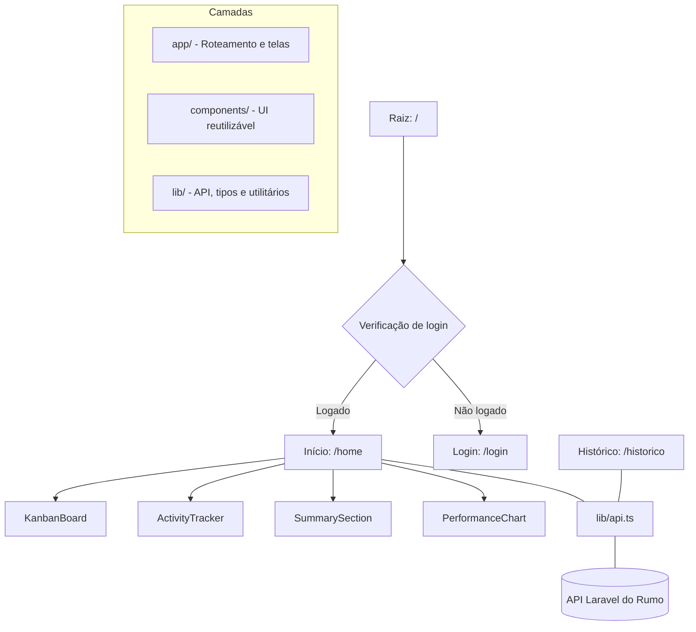

# Rumo 🎯

[]()
[]()
[]()
[]()

> "Direção clara, vida leve."

**Rumo** é uma plataforma de produtividade focada em transparência e progresso real. A interface reativa permite gerenciar objetivos, tarefas ativas (Kanban) e acompanhar a análise de desempenho em tempo real.

> **Status:** o app não está publicado no momento. Para usá-lo, rode o projeto localmente seguindo as instruções abaixo.

---

## Screenshots

> As imagens abaixo ficam em `docs/screenshots/` e serão adicionadas em breve.

| Kanban | Dashboard | Objetivos |
|--------|-----------|-----------|
|  |  |  |

---

## Início rápido

Rode o projeto localmente em menos de 2 minutos:

```bash
# Clone o repositório e entre na pasta
# Instale as dependências
npm install --legacy-peer-deps

# Rode em modo de desenvolvimento
npm run dev
```

O projeto ficará disponível em `http://localhost:3000`.

### Testes

```bash
# Modo watch
npm test

# Execução única
npm run test:run
```

---

## Arquitetura

O Rumo segue o padrão do Next.js App Router, com separação clara entre roteamento, componentes de interface e a camada de comunicação com a API.



---

## Variáveis de ambiente

O front-end se integra à API Laravel do Rumo para sincronização centralizada, com suporte a uso offline.

| Variável | Descrição | Obrigatória | Padrão / Exemplo |
|----------|-----------|-------------|------------------|
| `NEXT_PUBLIC_API_URL` | URL base da API REST do Rumo | Sim | Exemplo: `http://localhost:8080/api/v1` (padrão no código: `http://localhost/api/v1`) |
| `NODE_ENV` | Ambiente de execução | Não | `development` / `production` |

---

## Funcionalidades

Documentação específica de cada módulo principal:

1. [🏠 Dashboard (Início)](./app/home/README.md) - Gestão ativa de tarefas e análises.
2. [📜 Histórico](./app/historico/README.md) - Retrospectiva das tarefas concluídas.
3. [🔑 Login](./app/login/README.md) - Fluxo de autenticação e onboarding.

---

## Stack tecnológica

- **Base**: Next.js 16, React 19, TypeScript.
- **Interface**: Tailwind CSS 4, Radix UI, Framer Motion (transições fluidas).
- **Gráficos**: Recharts.
- **Validação**: Zod + React Hook Form.
- **Testes**: Vitest + Testing Library.

---
© 2026 Projeto Rumo.
